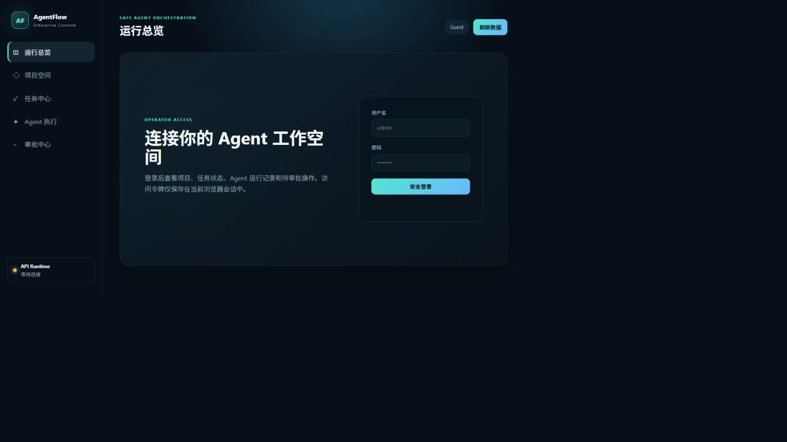
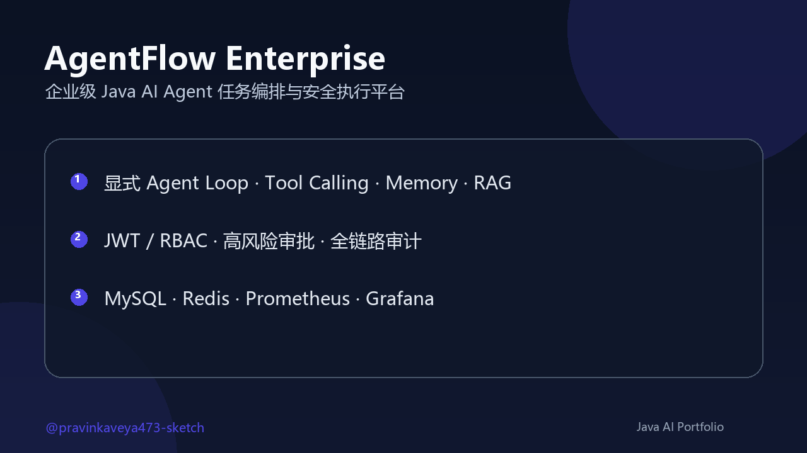
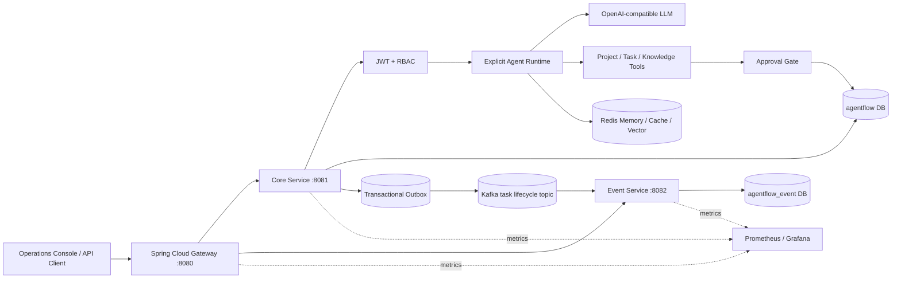

# AgentFlow Enterprise

<p align="center"></p>

<p align="center">
  <a href="https://github.com/pravinkaveya473-sketch/agentflow-enterprise/actions"></a>
  
  
  
  
  <a href="LICENSE"></a>
</p>

<p align="center"><strong>企业级 Java AI Agent 任务编排、安全审批与可审计执行平台</strong></p>

AgentFlow 3.0 将原模块化单体按渐进式迁移策略拆为 Spring Cloud Gateway、Core Service 与 Event Service。核心业务继续保留状态机、Agent Loop、人类审批、权限感知 RAG 和 Memory；任务生命周期通过事务 Outbox 写入 Kafka，由独立事件服务幂等消费并形成审计查询模型。

维护者：[@pravinkaveya473-sketch](https://github.com/pravinkaveya473-sketch) · 当前稳定版：`3.0.1` · [2.0 回退说明](docs/UPGRADE_ROLLBACK_V3.md)

[快速开始](#快速开始) · [微服务设计](docs/MICROSERVICES_V3.md) · [端到端验证](docs/E2E_VALIDATION_V3.md) · [升级与回退](docs/UPGRADE_ROLLBACK_V3.md) · [API 参考](docs/API.md) · [运维手册](docs/OPERATIONS.md) · [版本记录](CHANGELOG.md)

## 产品界面

应用内置响应式 Operations Console。登录后可统一查看项目、任务状态分布、待审批操作和最近 Agent Run，不需要额外部署前端工程。

<p align="center"></p>

<p align="center"></p>

## 核心价值

| 生产问题 | AgentFlow 的实现 |
|---|---|
| 模型如何稳定完成多步任务 | 应用显式控制 Model → Tool → Result 循环；限制模型次数、工具次数、总时长和重复调用 |
| Agent 如何安全修改业务数据 | JWT + RBAC + 领域状态机；高风险删除必须通过审批并在同一事务中消费审批 |
| 多用户知识问答如何隔离 | 文档、向量过滤、Memory 会话均使用用户/知识库作用域；低相似度时拒绝编造 |
| 如何定位一次错误执行 | Run/Step、Task Activity、Approval、Trace ID 和 Micrometer 指标形成完整证据链 |
| 服务拆分后如何避免事件丢失 | Core 业务事务同时写 Outbox；后台确认 Kafka 发送成功后标记已发布 |
| Kafka 重投如何避免重复数据 | Event Service 以 `event_id` 主键幂等落库；失败消息重试 2 次后进入 DLT |
| 怎样证明仓库可以交付 | 19 项自动化测试、多服务 Compose、Smoke Test、CI、Dependabot 和标签发布流程 |

## 架构



### 执行不变量

- 模型不能直接访问数据库，只能调用已注册、受业务规则约束的 Java Tool。
- 工具执行前必须保留最终回答所需的模型调用预算，避免“副作用已发生但无最终结果”。
- 项目归档后不能创建任务；终态任务不能再次修改；阻塞任务必须包含原因。
- 审批只能被消费一次，并受状态、过期时间、资源 ID 和乐观锁共同保护。
- 用户只能访问自己拥有或被分配的任务、知识库和 Agent Run。
- 业务状态和 Outbox 在同一数据库事务中提交；Event Service 只接受可反序列化的版本化事件契约。

## 能力地图

### 协作域

- 项目创建、编辑、归档、恢复与用户级幂等键
- 项目内/独立任务、负责人、优先级、截止时间和状态筛选
- `CREATED → IN_PROGRESS → COMPLETED`、阻塞/恢复、取消和活动时间线
- JPA 乐观锁和数据库唯一约束处理并发更新与重复请求

### Agent Runtime

- 手动 Tool Calling 循环和项目/任务/知识工具注册
- 模型调用、工具调用、执行时间和重复调用保护
- Agent Run/Step 增量持久化、结果缓存、限流和会话 Memory
- JSONL 评估集与工具序列自动评估

### 安全与知识

- HS256 JWT、issuer 校验、`USER / APPROVER / ADMIN` RBAC
- 高风险操作申请、批准、拒绝、过期和一次性消费
- PDF、Word、TXT、Markdown 解析，扩展名/大小/字符数约束和 SHA-256 去重
- Redis VectorStore Top-K、相似度阈值、引用信息和租户过滤

### 可观测与交付

- Trace ID、Actuator、Prometheus 指标和 Grafana 数据源
- 内置 Operations Console 与聚合 Dashboard API
- Dockerfile、Docker Compose、健康探针、Smoke Test 和 HTTP 示例
- GitHub Actions CI、Dependabot 和 tag-based Release

### 微服务与事件驱动

- Spring Cloud Gateway 统一暴露 `8080`，核心服务与事件服务不直接暴露宿主机端口
- `agentflow-event-contract` 固化跨服务事件字段，避免复制内部领域实体
- 事务 Outbox 解决“业务提交成功但 Kafka 发送失败”的双写窗口
- Kafka 3 分区按任务 ID 保序；消费者以事件 ID 去重，失败消息进入 `.DLT`

## 技术栈

| Layer | Technology |
|---|---|
| Runtime | Java 21, Spring Boot 4.1, Spring AI 2.0 |
| Cloud | Spring Cloud 2025.1.2, Gateway Server WebFlux |
| Messaging | Apache Kafka 4.1, Spring Kafka, Transactional Outbox, DLT |
| Security | Spring Security, OAuth2 Resource Server, JWT |
| Persistence | Spring Data JPA, Flyway, MySQL 8.4 |
| AI data | Redis Stack VectorStore, Redis Chat Memory, Apache Tika |
| Operations | Actuator, Micrometer, Prometheus, Grafana, Docker Compose |
| Verification | JUnit 5, Mockito, Maven Wrapper, GitHub Actions |

## 快速开始

### 前置条件

- JDK 21
- Docker Desktop / Docker Engine with Compose
- DashScope 或其他兼容当前 OpenAI 配置的模型凭据

### 一条命令启动

```powershell
Copy-Item .env.example .env
# 将所有 replace-with-* 替换为本地安全值
docker compose up -d --build
```

打开：

- Operations Console: `http://localhost:8080`
- API: `http://localhost:8080/api/v1`
- Prometheus: `http://localhost:9090`
- Grafana: `http://localhost:3000`

首次启动会根据环境变量创建管理员账户。不要在公共环境沿用示例密码。

### 本地开发

```powershell
docker compose up -d mysql redis
$env:DASHSCOPE_API_KEY="your-key"
$env:JWT_SECRET="a-random-secret-with-at-least-32-bytes"
$env:MYSQL_PASSWORD="your-mysql-password"
$env:REDIS_PASSWORD="your-redis-password"
$env:ADMIN_PASSWORD="your-admin-password"
docker compose up -d kafka
.\mvnw.cmd -pl services/core-service -am spring-boot:run
```

### 网络受限环境构建

若容器内无法稳定访问 Maven Central，可先使用宿主机 Maven 缓存构建 JAR，再用纯运行时镜像启动；业务拓扑与默认 Compose 保持一致：

```powershell
.\mvnw.cmd clean package -DskipTests
docker compose -f compose.yaml -f compose.runtime.yaml --env-file .env up -d --build
```

## 验证

```powershell
.\mvnw.cmd clean verify
powershell -ExecutionPolicy Bypass -File .\scripts\smoke-test.ps1
```

当前 19 项测试覆盖领域状态迁移、审批生命周期、知识文件策略、Agent 运行上下文、任务服务权限、Outbox 事件映射和 Event Service 重复事件过滤。CI 在每次 push 和 pull request 上运行。

`3.0.1` 已在 Docker Desktop 29.6.2 上完成完整容器验证，包括 Gateway → Core → Outbox → Kafka → Event Service 业务闭环，以及 Prometheus 三服务抓取和 Grafana 健康检查；详见[验证记录](docs/E2E_VALIDATION_V3.md)。

## 目录

```text
libs/event-contract        # 版本化 Kafka 事件契约
services/core-service      # 原成熟业务域 + Outbox + Kafka Producer
services/event-service     # Kafka Consumer + 独立审计读模型
services/gateway-service   # Spring Cloud Gateway 统一入口
deploy/mysql/init          # 独立事件数据库初始化
docs/MICROSERVICES_V3.md   # 服务边界与可靠性设计
docs/UPGRADE_ROLLBACK_V3.md# 2.0 → 3.0 升级及回退步骤
```

## 适用边界

这是一个可构建、可测试、可本地部署的工程作品。3.0 采用小规模渐进式拆分，未声称所有业务域均已独立服务化，也不声称承载过真实生产流量。正式生产使用前仍需接入 Schema Registry、企业密钥管理、TLS、数据库备份、集中日志、告警和容量测试。

## License

[MIT](LICENSE) © [pravinkaveya473-sketch](https://github.com/pravinkaveya473-sketch)
