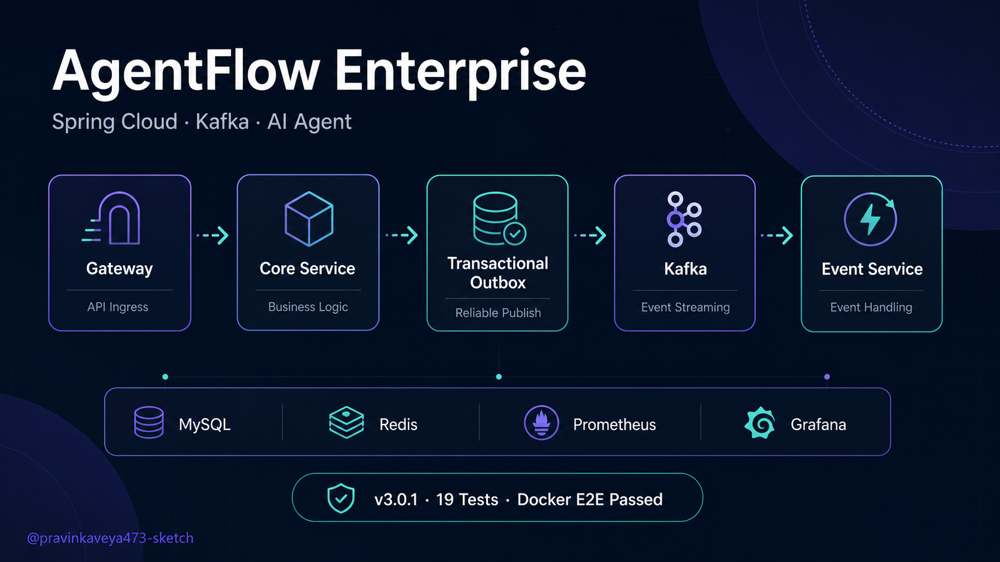
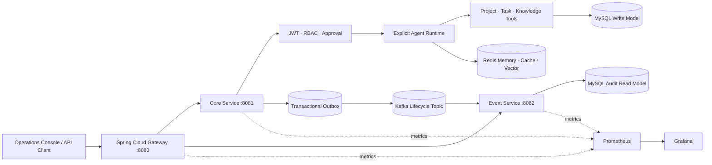

# AgentFlow Enterprise

<p align="center">
  
</p>

<p align="center">
  <a href="https://github.com/pravinkaveya473-sketch/agentflow-enterprise/actions/workflows/ci.yml"></a>
  <a href="https://github.com/pravinkaveya473-sketch/agentflow-enterprise/releases/tag/v3.0.1"></a>
  
  
  
</p>

<p align="center">
  <strong>面向企业任务协作场景的 Java AI Agent 编排、安全审批与事件驱动审计平台</strong>
</p>

<p align="center">
  <a href="#项目概览">项目概览</a> ·
  <a href="#架构设计">架构设计</a> ·
  <a href="#5-分钟运行">快速运行</a> ·
  <a href="docs/DEMO.md">面试演示</a> ·
  <a href="docs/E2E_VALIDATION_V3.md">验证证据</a> ·
  <a href="docs/API.md">API 文档</a>
</p>

---

## 项目概览

AgentFlow Enterprise 是一个可构建、可测试、可通过 Docker Compose 完整启动的工程化项目。系统围绕“让 AI Agent 在明确的业务、安全和审计边界内执行任务”展开，而非停留在单次模型对话 Demo。

`3.0.1` 采用 Spring Cloud Gateway + Core Service + Event Service 的小规模微服务架构。Core Service 在同一事务中提交业务状态与 Outbox 事件，后台可靠发布至 Kafka；Event Service 幂等消费并维护独立审计读模型。原有 Agent Loop、RBAC、审批、RAG、Memory、状态机和可观测能力全部保留。

| 项目维度 | 当前状态 |
|---|---|
| 项目性质 | 完整个人工程项目 / Java 后端与 AI Agent 作品集 |
| 当前版本 | [`v3.0.1`](https://github.com/pravinkaveya473-sketch/agentflow-enterprise/releases/tag/v3.0.1) |
| 服务组成 | Gateway、Core Service、Event Service |
| 核心中间件 | MySQL 8.4、Redis Stack、Kafka 4.1 |
| 工程验证 | 19 项自动化测试 + 9 步业务 Smoke Test + Docker E2E |
| 可观测性 | Actuator、Micrometer、Prometheus、Grafana |
| 回退能力 | `v2.0.0` 模块化单体基线 + `v3.0.0` 微服务初版标签 |
| 维护者 | [@pravinkaveya473-sketch](https://github.com/pravinkaveya473-sketch) |

## 面试官可以重点看什么

| 工程问题 | 项目中的实现 | 代码/文档入口 |
|---|---|---|
| 服务拆分后怎样避免事件丢失 | 业务数据与 Outbox 同事务提交，发布成功后回写 `published_at` | `TaskEventOutboxPublisher` / [微服务设计](docs/MICROSERVICES_V3.md) |
| Kafka 重投怎样避免重复审计 | `event_id` 主键幂等，消费失败重试 2 次后进入 DLT | `TaskEventConsumer` / `KafkaConfig` |
| Agent 怎样避免无限调用和越权副作用 | 显式 Agent Loop、调用预算、重复检测、RBAC 与审批门禁 | `TaskAgentService` / `ApprovalService` |
| 任务规则怎样保持一致 | 状态迁移封装在领域实体，Controller、Service、Tool 共用规则 | `TaskEntity` / `TaskService` |
| 多用户 RAG 怎样隔离 | 文档元数据、向量过滤、Memory 会话均带用户与知识库作用域 | `KnowledgeService` |
| 如何证明系统真的能运行 | 自动化 Smoke Test 覆盖 Gateway → Outbox → Kafka → Event 查询 | [`scripts/smoke-test.ps1`](scripts/smoke-test.ps1) / [E2E 记录](docs/E2E_VALIDATION_V3.md) |

## 功能全景

### AI Agent 与知识能力

- 显式控制 `Model → Tool → Result` 循环，支持工具调用次数、模型次数、总时长与重复调用保护。
- Agent Run/Step 增量持久化，记录每轮输入、工具、结果、耗时和最终状态。
- Redis Chat Memory、运行缓存、限流与幂等控制。
- PDF、Word、TXT、Markdown 文档入库，Redis VectorStore 检索、引用返回和租户过滤。
- JSONL 评估集与 Agent 工具序列评估。

### 企业任务协作

- 项目创建、编辑、归档、恢复和用户级幂等键。
- 任务负责人、优先级、截止时间、状态筛选和活动时间线。
- `CREATED → IN_PROGRESS → COMPLETED` 主流程，以及阻塞、恢复、取消等受控迁移。
- JPA 乐观锁、数据库唯一约束和事务边界处理并发与重复请求。

### 安全、审批与审计

- HS256 JWT、issuer 校验、`USER / APPROVER / ADMIN` RBAC。
- 高风险操作支持申请、批准、拒绝、过期和一次性消费。
- 审批消费与业务副作用处于同一事务，失败时共同回滚。
- Trace ID、Task Activity、Agent Run/Step、事件读模型组成端到端证据链。

### 微服务与消息可靠性

- Spring Cloud Gateway 作为唯一公开入口，内部服务不暴露宿主机业务端口。
- 版本化 `agentflow-event-contract` 固化跨服务契约。
- Transactional Outbox 消除业务提交与 Kafka 发布之间的双写窗口。
- Kafka 3 分区按任务 ID 保序；消费者幂等落库并配置独立 DLT。

## 架构设计



### 一次任务事件的完整路径

```text
Client
  → Gateway 鉴权入口
  → Core 执行业务状态机
  → MySQL 同事务写入 Task + Outbox
  → Outbox Publisher 发送 Kafka
  → Event Service 幂等消费
  → agentflow_event 独立读模型
  → Gateway 返回审计查询结果
```

### 关键设计不变量

- 模型不能直接访问数据库，只能调用已注册且受领域规则约束的 Java Tool。
- 工具执行前必须预留最终回答所需模型预算，避免“副作用已发生但没有最终结果”。
- 项目归档后不能创建任务；终态任务不能再次修改；阻塞任务必须记录原因。
- 审批只能消费一次，并受状态、过期时间、资源 ID 与乐观锁共同保护。
- 业务状态与 Outbox 在同一事务中提交；消费者使用事件 ID 去重。
- MySQL 保存业务事实，Redis 负责缓存、限流、Memory 与向量数据，两者职责不互相替代。

## 产品展示

应用内置响应式 Operations Console，可统一查看项目、任务状态、审批操作和最近 Agent Run，无需额外部署前端项目。

<p align="center">
  
</p>

<details>
<summary><strong>展开查看动态演示</strong></summary>

<p align="center">
  
</p>

</details>

## 技术栈

| 层次 | 技术选型 |
|---|---|
| Runtime | Java 21、Spring Boot 4.1、Spring AI 2.0 |
| Cloud | Spring Cloud 2025.1.2、Gateway Server WebFlux |
| Messaging | Apache Kafka 4.1、Spring Kafka、Transactional Outbox、DLT |
| Security | Spring Security、OAuth2 Resource Server、JWT、RBAC |
| Persistence | Spring Data JPA、Flyway、MySQL 8.4 |
| AI Data | Redis Stack VectorStore、Redis Chat Memory、Apache Tika |
| Operations | Actuator、Micrometer、Prometheus、Grafana、Docker Compose |
| Quality | JUnit 5、Mockito、Maven Wrapper、GitHub Actions、Dependabot |

## 5 分钟运行

### 环境要求

- JDK 21
- Docker Desktop 或 Docker Engine + Compose
- DashScope 或 OpenAI-compatible 模型凭据（仅 AI/RAG 调用需要）

### 完整 Compose 启动

```powershell
Copy-Item .env.example .env
# 修改 .env 中所有 replace-with-* 占位值
docker compose up -d --build
docker compose ps
```

若容器内访问 Maven Central 不稳定，可使用已经验证的宿主机 JAR 构建模式：

```powershell
.\mvnw.cmd clean package -DskipTests
docker compose -f compose.yaml -f compose.runtime.yaml --env-file .env up -d --build
```

| 服务 | 地址 | 用途 |
|---|---|---|
| Operations Console / API Gateway | <http://localhost:8080> | 统一业务入口 |
| Prometheus | <http://localhost:9090> | 指标与 Target 状态 |
| Grafana | <http://localhost:3000> | 可观测数据展示 |

首次启动会根据环境变量创建管理员账户，请勿在公共环境使用示例密码。使用占位模型 Key 进行基础设施验证时保持 `VECTOR_STORE_INITIALIZE_SCHEMA=false`；验证真实 RAG 时填写有效 Key 并改为 `true`。

## 验证与质量证据

```powershell
.\mvnw.cmd clean verify
powershell -ExecutionPolicy Bypass -File .\scripts\smoke-test.ps1
```

当前验证结果：

- `19/19` 自动化测试通过，覆盖领域状态迁移、审批生命周期、任务权限、Outbox 映射和消费者幂等。
- 9 步 Smoke Test 跑通注册、项目、任务全状态流转、Core 审计和 Kafka 事件读模型。
- Docker Compose 中 Gateway、Core、Event、MySQL、Redis、Kafka 全部健康。
- Prometheus 的三个应用目标全部为 `up`，Grafana 数据库健康状态为 `ok`。
- 详细环境、任务 ID 与验证边界见 [Docker E2E 验证记录](docs/E2E_VALIDATION_V3.md)。

## API 概览

| API | 作用 |
|---|---|
| `POST /api/v1/auth/register` | 注册并签发 JWT |
| `POST /api/v1/projects` | 创建项目，支持幂等键 |
| `POST /api/v1/tasks` | 创建任务并产生生命周期事件 |
| `POST /api/v1/agents/task/runs` | 启动受控 Agent Run |
| `POST /api/v1/approvals/{id}/approve` | 审批高风险操作 |
| `POST /api/v1/knowledge/{base}/ask` | 租户隔离的 RAG 问答 |
| `GET /api/v1/events` | 查询 Kafka 消费形成的审计读模型 |

完整请求、字段和权限要求见 [API 文档](docs/API.md) 与 [`api-examples.http`](api-examples.http)。

## 项目结构

```text
agentflow-enterprise/
├─ libs/event-contract/        # 版本化 Kafka 事件契约
├─ services/core-service/      # 业务域、Agent、审批、RAG、Outbox Producer
├─ services/event-service/     # Kafka Consumer 与独立审计读模型
├─ services/gateway-service/   # Spring Cloud Gateway 统一入口
├─ deploy/                     # MySQL、Prometheus、Grafana 配置
├─ scripts/                    # 自动化验证与业务 Smoke Test
├─ docs/                       # 架构、API、演示、运维、升级回退文档
├─ compose.yaml                # 完整容器拓扑
└─ pom.xml                     # Maven 多模块父工程
```

## 文档导航

| 文档 | 内容 |
|---|---|
| [微服务架构设计](docs/MICROSERVICES_V3.md) | 服务边界、事件契约与可靠性方案 |
| [Docker E2E 验证](docs/E2E_VALIDATION_V3.md) | 真实启动环境、验证路径和结果 |
| [5 分钟面试演示](docs/DEMO.md) | 演示顺序与技术讲解重点 |
| [API 参考](docs/API.md) | API、认证和请求示例 |
| [运维手册](docs/OPERATIONS.md) | 健康检查、Kafka、备份与恢复 |
| [升级与回退](docs/UPGRADE_ROLLBACK_V3.md) | `2.0 → 3.x` 迁移和回退步骤 |
| [版本记录](CHANGELOG.md) | 版本演进与修复内容 |
| [安全策略](SECURITY.md) | 漏洞报告与密钥管理 |

## 版本与回退

- `v3.0.1`：完成 Docker/Kafka 端到端验证的当前稳定版。
- `v3.0.0`：Spring Cloud + Kafka 微服务初版。
- `v2.0.0`：完整模块化单体基线；另保留 `archive/v2.0.0-modular-monolith` 分支。

## 工程边界

本项目已完成本地构建、自动化测试和 Docker 端到端部署验证，但不虚构真实生产流量。正式生产落地仍需补充企业密钥管理、Kafka TLS/SASL、多节点高可用、Schema Registry、集中日志、告警、备份演练和容量测试。

## License

[MIT](LICENSE) © [pravinkaveya473-sketch](https://github.com/pravinkaveya473-sketch)
