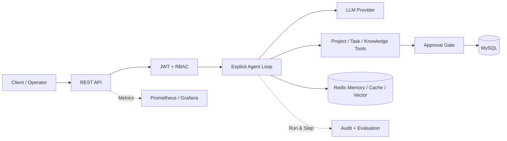

# AgentFlow Enterprise

<p align="center">
  
</p>

<p align="center">
  <a href="https://github.com/pravinkaveya473-sketch/agentflow-enterprise/actions"></a>
  
  
  
  
</p>

面向企业协作场景的 **Java AI Agent 任务编排与安全执行平台**。项目基于 Java 21、Spring Boot 4.1 和 Spring AI 2.0，应用侧显式控制“模型调用 → 工具执行 → 结果回传”的循环，并将项目、任务、状态机、审批、审计、RAG、Memory、MySQL、Redis 和可观测性组合为一条可追踪的业务链路。

> 面试速览：这不是一个只封装 Chat API 的 Demo，而是一套把 **Agent 执行、业务状态机、安全审批、审计证据和可观测性** 放进同一条生产链路的工程化实现。

维护者：[@pravinkaveya473-sketch](https://github.com/pravinkaveya473-sketch)

[功能演示](docs/DEMO.md) · [架构说明](docs/ARCHITECTURE.md) · [接口示例](api-examples.http) · [构建验证](BUILD_VALIDATION.md)

## 项目演示

<p align="center">
  
</p>

## 为什么值得看

| 工程问题 | AgentFlow 的回答 |
|---|---|
| 模型如何稳定完成多步任务 | 显式 Agent Loop、步数预算、重复调用检测、Run/Step 持久化 |
| 高风险动作如何受控 | JWT + RBAC + 审批状态机，审批与删除处于同一事务 |
| 知识问答如何避免越权 | 用户/知识库隔离、上传策略、去重、阈值与引用信息 |
| 故障如何定位 | Trace ID、Micrometer、Prometheus、Grafana 与运行审计 |
| 如何证明工程可用 | 15 项自动化测试、Docker Compose、HTTP 示例与 Smoke Test |

## 架构概览



> 当前版本：`2.0.0-phase1`。本版本完成第一轮企业化改造；后续仍需在真实联网环境执行 Maven 全量构建和 MySQL/Redis/Qwen 端到端验证。

## 1. 核心业务

### 项目管理

- 创建、查询、修改、归档和恢复项目
- 项目创建支持用户级幂等键
- `ACTIVE → ARCHIVED → ACTIVE` 状态约束
- 归档项目禁止继续创建任务
- `@Version` 乐观锁处理并发覆盖

### 企业任务

- 任务可归属项目，也可作为独立任务存在
- 名称、描述、负责人、截止时间和优先级
- 支持按项目和状态筛选
- 负责人必须是真实启用用户；负责人可查看并推进被分配任务
- 状态机：

```text
CREATED → IN_PROGRESS → COMPLETED
    │           │
    ├───────────┴→ BLOCKED → IN_PROGRESS
    └──────────────────────→ CANCELLED
```

- 阻塞任务必须记录阻塞原因
- 终态任务禁止再次修改
- 每次创建、更新、开始、阻塞、恢复、完成、取消和删除均写入 `task_activity`

### Agent Runtime

- 手动 Tool Calling 循环，而不是把全部控制权交给框架
- 项目工具、任务工具和知识工具统一注册
- 模型调用次数、工具调用次数和总时长限制
- 重复工具调用检测
- `AgentRun`、`AgentStep` 全链路持久化
- Agent 步骤采用增量追加，避免每轮删除并重插全部审计数据
- Redis 幂等、限流、运行缓存和多轮 Memory

### 安全审批

- JWT HS256、issuer 校验、RBAC
- 仅接受 Bearer JWT，不再额外开放 HTTP Basic 认证入口
- 删除任务必须经过 `APPROVER/ADMIN` 审批
- 审批与删除处于同一数据库事务
- 审批增加乐观锁、消费时间和自动过期扫描
- 过期、拒绝、已消费或资源不匹配的审批不能执行操作

### RAG

- Tika 解析 PDF、Word、TXT 和 Markdown
- 上传扩展名白名单
- 解析文本字符上限，降低异常大文档风险
- SHA-256 文档去重
- Redis VectorStore、Top-K、相似度阈值和引用信息
- 用户与知识库隔离
- 上下文不足时拒绝编造

### 可观测性与评估

- Trace ID、Actuator、Prometheus、Grafana
- Agent 运行量、耗时、模型调用数和工具调用数
- JSONL Agent 数据集
- 工具序列自动评估并持久化结果
- 当前评估集覆盖项目创建、任务创建、查询和多工具状态迁移

## 2. 主要技术栈

- Java 21
- Spring Boot 4.1.0
- Spring AI 2.0.0
- Spring Security / OAuth2 Resource Server
- Spring Data JPA / Flyway / MySQL 8.4
- Redis Stack / Redis VectorStore / Redis Chat Memory
- Micrometer / Prometheus / Grafana
- Docker Compose

## 3. 代码结构

```text
src/main/java/com/cjl/java_ai_agent
├── agent              # 显式 Agent 循环、Run/Step 审计
├── ai                 # 普通对话接口
├── approval           # 高风险操作审批与自动过期
├── common             # 统一响应、异常和 TraceId
├── config             # ChatClient、Memory、配置属性
├── evaluation         # Agent 数据集评估
├── infrastructure     # Redis 幂等、限流、缓存
├── knowledge          # 文档解析、向量入库、RAG
├── memory             # 会话命名空间和 Memory API
├── observability      # Micrometer 指标
├── project            # 企业项目聚合、接口和 Agent Tool
├── security           # JWT、RBAC、用户管理
└── task               # 任务聚合、状态机、活动审计和 Tool
```

## 4. 数据库迁移

- `V1__init.sql`：用户、任务、Agent Run/Step、审批、知识文档和评估
- `V2__agentflow_project_and_audit.sql`：
  - 新增 `project`
  - 任务增加项目、描述、负责人和阻塞原因
  - 新增 `task_activity`
  - Agent Run 和审批增加乐观锁
  - 审批增加 `consumed_at`

## 5. 本地启动

### 环境

- JDK 21
- Docker Desktop
- 有效 DashScope API Key

### 基础设施使用 Docker，应用在 IDEA 运行

```powershell
Copy-Item .env.example .env
# 替换 .env 中全部 replace-with-* 值；应用不会提供弱口令回退值

docker compose up -d mysql redis

$env:DASHSCOPE_API_KEY="你的 Key"
$env:JWT_SECRET="至少32字节的随机字符串"
$env:MYSQL_PASSWORD="你的数据库密码"
$env:REDIS_PASSWORD="你的 Redis 密码"
$env:ADMIN_PASSWORD="你的管理员密码"
.\mvnw.cmd clean spring-boot:run
```

### 全部使用 Docker Compose

```powershell
Copy-Item .env.example .env
# 必须替换 .env 中所有 replace-with-* 值

docker compose up -d --build
```

服务：

| 服务 | 地址 |
|---|---|
| API | `http://localhost:8080` |
| Prometheus | `http://localhost:9090` |
| Grafana | `http://localhost:3000` |

接口调用示例见 `api-examples.http`。

## 6. 第一轮改造成果

详细改动、风险和下一阶段计划见：

- `docs/PHASE1_CHANGELOG.md`
- `docs/ARCHITECTURE.md`
- `BUILD_VALIDATION.md`

## 7. 后续改造计划

第二轮重点：

1. 增加 Workspace、Team、成员关系和真正的任务分配权限
2. 建立 `AgentPlan/PlanStep`，支持计划生成、暂停、恢复与重新规划
3. 将审批与 Agent Run 绑定，实现审批后从原运行上下文恢复
4. 增加前端任务看板、审批中心和 Agent Trace 页面
5. 补齐 Repository、Service、Controller 和 Testcontainers 测试
6. 建立 50～100 条评估集并输出任务完成率、参数准确率、P95 延迟等真实数据

## 8. 项目真实性说明

简历中只描述已经实现并通过验证的内容。当前版本已经完成源码改造和静态结构校验，但在没有执行 Maven 全量依赖解析、Spring 上下文启动和端到端测试前，不应描述为“生产上线系统”。
