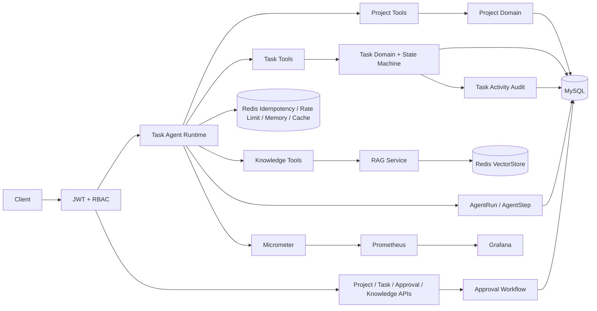

# AgentFlow Enterprise 架构说明

## 关键设计决策

### 领域规则放在实体中

任务的开始、阻塞、恢复、完成和取消必须调用 `TaskEntity` 领域方法。Controller、Service 和 Agent Tool 不允许直接设置状态字段。

### 数据库与 Redis 分工

- MySQL：业务事实、审计、审批和最终状态
- Redis：快速幂等、限流、运行缓存、Chat Memory 和向量检索

Redis 失败不能替代 MySQL 的唯一约束和事务边界。

### Agent 显式循环

应用主动关闭 ChatClient 自动工具循环，使用 `ToolCallingManager` 执行每一轮工具调用，从而插入：

- 次数上限
- 总超时
- 重复调用检测
- Run/Step 审计
- 指标
- 可插入审批、策略和评估等控制点

### 审批与副作用同事务

审批消费与任务删除必须在同一个事务中完成。删除失败时，审批消费也回滚，避免审批被浪费但操作没有执行。
