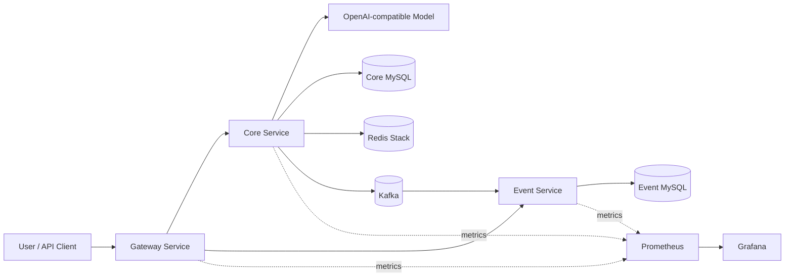
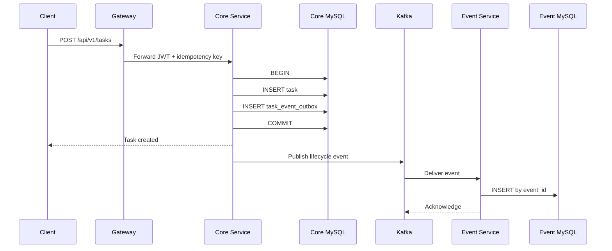

# AgentFlow Enterprise 架构说明

## 系统上下文

## 服务职责

| 模块 | 核心职责 | 数据所有权 |
|---|---|---|
| Gateway Service | 统一入口、路由、外部端口收敛 | 无业务数据 |
| Core Service | 项目、任务、Agent、审批、RAG、用户与 Outbox | `agentflow` 数据库 |
| Event Service | Kafka 消费、事件幂等、审计查询 API | `agentflow_event` 数据库 |
| Event Contract | 跨服务版本化事件 DTO | 无运行时状态 |

## 任务写入与事件发布

## 关键设计决策

### 渐进式微服务拆分

系统保留成熟 Core 业务域，只拆出统一网关和异步审计 Event Service。这样能够真实展示服务边界、独立数据库和消息可靠性，同时控制分布式复杂度。

### Transactional Outbox

任务状态与 Outbox 记录在同一数据库事务中提交，避免“数据库成功但 Kafka 失败”的双写不一致。后台 Publisher 对未发布记录进行重试，并在 Broker 确认后写入发布时间。

### 至少一次投递与消费幂等

Outbox 重试可能导致重复事件，因此 Event Service 使用 `event_id` 主键去重。消费失败执行有限重试，超过次数后进入 DLT，避免异常消息无限阻塞分区。

### 领域规则单一入口

任务开始、阻塞、恢复、完成和取消必须调用 `TaskEntity` 的领域方法。REST Controller、Application Service 与 Agent Tool 共用同一套状态机，避免不同入口产生不一致规则。

### Agent 显式循环

应用显式控制每轮模型与工具调用，以便插入次数预算、总超时、重复调用检测、Run/Step 审计、指标、审批和评估。模型不能绕过 Tool 直接访问数据库。

### 数据库与 Redis 分工

- MySQL：业务事实、状态、审批、审计和 Outbox。
- Redis：幂等、限流、运行缓存、Chat Memory 和向量检索。

Redis 的可恢复数据不替代 MySQL 的事务与唯一约束。

## 安全边界

- Gateway 收敛外部入口，但各服务仍独立校验 JWT，避免仅依赖网络边界。
- Core 通过角色和资源所有权控制项目、任务、知识库与 Agent Run。
- 高风险副作用需要有效、未过期、资源匹配且尚未消费的审批记录。
- 所有真实凭据由环境变量注入，不写入代码、镜像与 `.env.example`。

## 可观测性

三个 Java 服务分别暴露 readiness、liveness、metrics 与 Prometheus 端点。业务层记录 Agent 执行时长、结果、模型调用次数和工具调用次数；Trace ID 贯穿 HTTP 请求，业务活动和事件读模型补充审计证据。

## 可靠性边界

本地 Compose 使用单节点 KRaft Kafka，适合复现和面试演示。生产部署需要多控制器 Quorum、TLS/SASL、Schema Registry、告警、容量评估和跨数据库备份策略。
