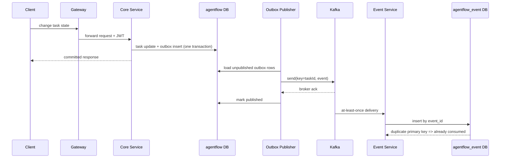

# AgentFlow 3.0 微服务与 Kafka 设计

## 1. 改造目标

3.0 不是把每个包机械拆成服务，而是先拆出具有独立扩缩容和数据所有权价值的边界：统一流量入口、核心业务写模型、异步事件读模型。原有 Agent、项目、任务、审批和 RAG 之间仍有大量强一致协作，因此暂时保留在 Core Service，避免引入分布式事务和跨服务聊天调用。

## 2. 服务边界

| 模块 | 端口 | 数据所有权 | 主要职责 |
|---|---:|---|---|
| Gateway Service | 8080 | 无 | Spring Cloud Gateway 统一路由、健康检查与指标 |
| Core Service | 8081 | `agentflow` | 项目/任务状态机、Agent Runtime、审批、RAG、Outbox |
| Event Service | 8082 | `agentflow_event` | Kafka 幂等消费、任务事件查询模型、DLT |
| Event Contract | - | 无 | 跨服务 `TaskLifecycleEvent` 契约 |

容器部署时只有 Gateway 映射宿主机端口。Core 与 Event Service 仅通过 Compose 网络访问，两个服务分别运行 Flyway 并管理自己的表。

## 3. 事件链路



### 可靠性取舍

- Core 在同一 MySQL 事务内提交任务状态和 Outbox，消除直接“双写数据库与 Kafka”的丢失窗口。
- Producer 使用 `acks=all` 与幂等生产者；按 `taskId` 作为 Kafka key 保证单个任务在同一分区内有序。
- Publisher 只有收到 broker ack 才写 `published_at`；发送失败保留记录并累计 `attempt_count`，下轮继续发送。
- Consumer 采用 at-least-once 语义，并以 `event_id` 主键实现业务幂等。
- 消费失败按 1 秒间隔重试 2 次，仍失败则写入 `agentflow.task.lifecycle.v1.DLT`。

当前实现没有声称跨 MySQL 与 Kafka 的全局 exactly-once；它使用行业常见的 Outbox + 幂等消费组合实现可恢复的最终一致性。

## 4. 事件契约

`TaskLifecycleEvent` 包含 `eventId`、`eventType`、`aggregateId`、`aggregateVersion`、任务最小快照、状态变化和事件时间。事件契约独立于 JPA 实体，避免把 Core Service 的内部表结构泄露给消费者。后续不兼容变更应创建 `v2` topic 或使用 Schema Registry 管理兼容策略。

## 5. 路由与安全

- `/api/v1/events/**` → Event Service
- 其他路径 → Core Service

Event Service 使用与 Core 相同的 HS256 JWT secret 和 issuer 验证访问令牌，并按当前用户名过滤事件记录。

## 6. 验证

```powershell
.\mvnw.cmd clean verify
docker compose --env-file .env.example config --quiet
docker compose up -d --build
docker compose ps
```

通过 Gateway 创建或推进任务后，使用同一 Bearer Token 查询 `GET http://localhost:8080/api/v1/events`。

## 7. 后续演进

1. 为事件契约接入 Schema Registry 与兼容性检查；
2. Outbox Publisher 增加 `FOR UPDATE SKIP LOCKED`，支持多副本并发发布；
3. 将知识摄取等计算密集型流程进一步拆为独立服务；
4. 接入集中式日志、OpenTelemetry Collector 和告警规则；
5. 生产环境使用三节点 controller quorum，而不是本地 Compose 的单节点 KRaft。
